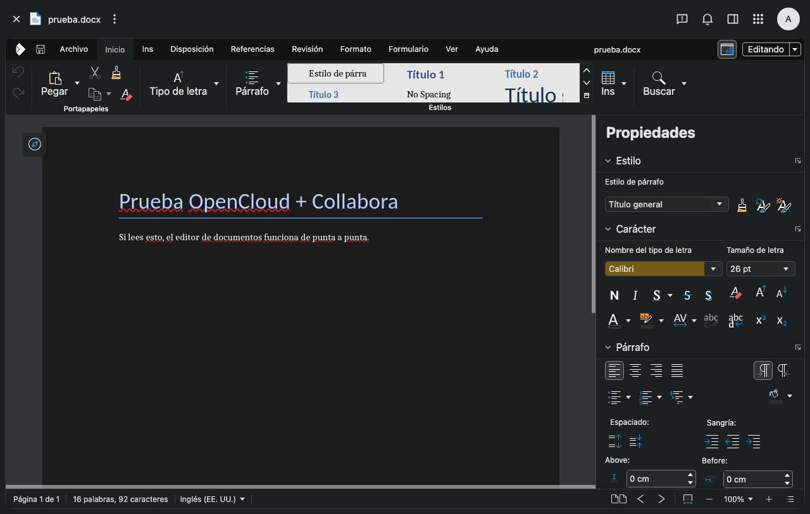

# OpenCloud (nube de archivos del equipo)

Instancia de OpenCloud con Collabora para el trabajo colaborativo del equipo
(archivos, espacios compartidos y edición de documentos en el navegador).

| Dato | Valor |
| --- | --- |
| Panel | <https://nube.bertika.com> |
| Editor (Collabora) | <https://collabora.bertika.com> |
| Versión OpenCloud | 8.1.0 (`opencloudeu/opencloud-rolling:8.1.0`) |
| Versión Collabora | 26.04.5.1 (`collabora/code`) |
| Servidor | VPS de producción (`srv1981179.hstgr.cloud`, 2.25.220.174) |
| Carpeta del stack | `/opt/opencloud` |
| Datos | `/var/lib/opencloud` (config + storage) |
| Secretos | `/opt/opencloud/.env` (600 root) |
| Credenciales iniciales | `/root/opencloud-credenciales.txt` (600 root) |
| Respaldo | `/var/backups/opencloud` + `/usr/local/bin/opencloud-backup.sh` |



Verificación hecha el día de la instalación: login con `admin`, subida de un
`.docx`, apertura en el editor y pedidos WOPI (`/wopi/files/...` y
`.../contents`) respondiendo 200.

## Cómo está armado

- **Docker + Compose** (paquetes de Ubuntu). El stack vive en `/opt/opencloud`,
  clonado de `opencloud-eu/opencloud-compose` con dos archivos propios:
  - `.env`: dominio, secretos, SMTP y combinación de compose.
  - `zz-bertika.override.yml`: fija `nube.bertika.com` y `collabora.bertika.com`
    al gateway del host para que los contenedores se hablen sin depender del
    resolver del VPS (que tarda en ver los subdominios nuevos).
- **Nginx del host** es el proxy externo (no se usa Traefik). Config en
  `/etc/nginx/sites-available/opencloud` (habilitada en `sites-enabled`).
  TLS con Let's Encrypt; certificado en `/etc/letsencrypt/live/nube.bertika.com/`.
- Los contenedores publican **solo en 127.0.0.1** (`9200` OpenCloud, `9980`
  Collabora). No hay puertos nuevos expuestos a internet.
- Servicios: `opencloud` (servidor + IDP + WOPI), `collabora` (editor),
  `yjs` (edición colaborativa de notas de texto). `restart: always`, Docker
  habilitado al arranque.

## Operación diaria

```bash
cd /opt/opencloud

docker compose ps                 # estado
docker compose logs -f opencloud  # logs
docker compose restart opencloud  # reiniciar solo el panel
docker compose up -d              # aplicar cambios del .env
docker compose down               # apagar todo
```

**Usuarios y espacios:** se administran desde la interfaz (`admin`) o por la
API Graph. Usuario `admin` + claves en `/root/opencloud-credenciales.txt`:

```bash
ssh bertika-vps 'cat /root/opencloud-credenciales.txt'
```

## Equipo y espacios (creado el 24/10/2026)

| Persona | Usuario | Correo | Grupo | Espacio que ve |
| --- | --- | --- | --- | --- |
| Marcos | `marcos` | marcos@bertika.com | Ventas | `Ventas` |
| Juan | `juan` | juan@bertika.com | Taller | `Taller` |
| Verónica | `veronica` | veronica@bertika.com | Administración | `Administración` |
| Delfina | `delfina` | delfina@bertika.com | Cobranzas | `Cobranzas` |

- Cada grupo es **Space Editor** de su espacio (puede crear, editar y borrar).
- `admin` es **Manager** de todos los espacios.
- Cuotas: **25 GB por espacio de área** y **10 GB por espacio personal**
  (`role_quotas` en `config/opencloud/proxy.yaml` para los personales).
- Las claves iniciales están en `/root/opencloud-credenciales.txt`; conviene que
  cada persona la cambie en su primer ingreso (Configuración → Seguridad).

**Pendiente:** `marcos@bertika.com`, `juan@bertika.com`, `veronica@bertika.com`
y `delfina@bertika.com` **no existen todavía en Hostinger**. Si no se crean como
casillas o alias, OpenCloud no puede enviarles avisos de compartidos ni
restablecer contraseñas por correo (el login sigue funcionando).

### Notas de la API (para futuras altas)

- Usuarios, grupos y espacios: `POST /graph/v1.0/users`, `/groups`, `/drives`.
- Invitar a un grupo a un espacio: `POST /graph/v1beta1/drives/{id}/root/invite`
  con `{"recipients":[{"objectId":"<grupo>","@libre.graph.recipient.type":"group"}],"roles":["58c63c02-1d89-4572-916a-870abc5a1b7d"]}`
  (`Space Editor`; `Manager` = `312c0871-5ef7-4b3a-85b6-0e4074c64049`).
- Las invitaciones y permisos **solo existen en `v1beta1`**; en `v1.0` dan 404.
- Para borrar un archivo, WebDAV es más simple que Graph:
  `DELETE /dav/spaces/{driveId}/{nombre}` con el token del admin (204).

Los archivos de los espacios son de la empresa; si alguien se va, se le quita el
acceso y los archivos quedan.

## Actualizar versiones

1. Anotar la versión actual (`OC_DOCKER_TAG` en `.env`).
2. Cambiar `OC_DOCKER_TAG` a la nueva (o `OC_DOCKER_IMAGE` si cambia el canal).
3. `docker compose pull && docker compose up -d`.
4. Probar login, subir un archivo y abrirlo con Collabora.

Si algo falla, volver al tag anterior y `docker compose up -d`.

## Respaldo y restauración

`/usr/local/bin/opencloud-backup.sh` corre por cron a las **03:30** (después del
respaldo de la base de Bertika de las 03:17). Detiene el stack unos segundos
para que el `tar` sea consistente, comprime `/var/lib/opencloud` en
`/var/backups/opencloud/opencloud_AAAA-MM-DD_HHMM.tar.gz` y conserva 7 días.

Restaurar:

```bash
cd /opt/opencloud
docker compose down
tar xzf /var/backups/opencloud/opencloud_<fecha>.tar.gz -C /
docker compose up -d
```

**Pendiente:** el respaldo vive en el mismo disco. Falta copiarlo fuera del
servidor (almacenamiento externo o snapshot del proveedor).

## Certificados

`certbot` renueva solo (timer del sistema). Hay un hook en
`/etc/letsencrypt/renewal-hooks/deploy/reload-nginx.sh` que recarga nginx
después de renovar. El certificado cubre `nube.bertika.com` y
`collabora.bertika.com`.

Republicar desde cero (si cambian los dominios o se rompe el sitio):

```bash
bash /opt/opencloud/publicar.sh
```

## Integración con el panel de Bertika (pendiente)

Idea acordada: en la ficha del cliente, un botón **“Abrir carpeta”** que lleve
a la carpeta del cliente en OpenCloud. El panel sigue siendo el dueño de la
operación (órdenes, stock, facturación); OpenCloud guarda y comparte archivos.

## Notas y diagnóstico

- **502 intermitente en `/signin/...`**: visto durante el arranque del
  contenedor (el IDP todavía no está listo). Si se repite seguido, revisar
  `docker compose logs opencloud`.
- **El resolver del VPS tarda en ver subdominios nuevos**: por eso el override
  con `extra_hosts`. Si se agrega otro dominio interno, sumarlo ahí.
- **Aviso de bienvenida de Collabora**: aparece la primera vez por navegador;
  se cierra con la X y no vuelve a molestar.
- **404 de íconos sueltos de Collabora**: cosmético (tema oscuro y
  extensiones); no afecta la edición.
- **No se habilitó autenticación básica** (`PROXY_ENABLE_BASIC_AUTH`): los
  clientes de escritorio usan OIDC. Si hiciera falta WebDAV con usuario y
  clave, se activa en `.env` y se reinicia.
